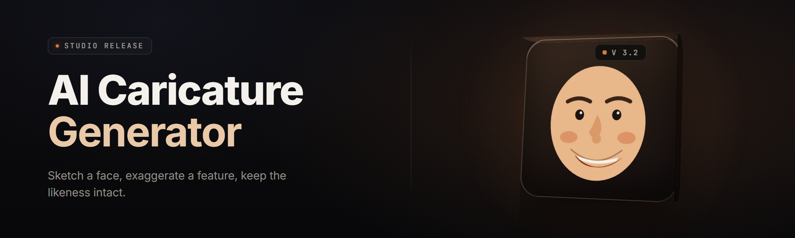

  
  
  

  

  
  

---

AI Caricature Generator is a Windows `.exe` that turns any face photo into a rubbery, big-nosed, big-eyed caricature in under four seconds — no GPU, no cloud, no account. Drop a headshot in, pick a distortion preset, and out comes a PNG ready for a birthday card, a group chat, or a wedding slideshow. It runs on a single threaded inference core with a swappable exaggeration engine, and yes — every preset is fully editable down to the warp field. **See FAQ for detection/updates.** — 

  

(#) after quick start.

---

## 📖 Table of Contents

- [What is … — Glossary](#-what-is--glossary)
- [Quick Start — Run the Tool](#-quick-start--run-the-tool)
- [Overview](#-overview)
- [The Problem](#-the-problem)
- [The Solution](#-the-solution)
- [Key Features](#-key-features)
- [Combat & Warp Engine Modules](#-combat--warp-engine-modules)
- [Crafting & Stylize Modules](#-crafting--stylize-modules)
- [Export & Batch Modules](#-export--batch-modules)
- [QoL & Workflow Modules](#-qol--workflow-modules)
- [Face Detect & Mesh Modules](#-face-detect--mesh-modules)
- [Comparison](#-comparison)
- [System Requirements](#-system-requirements)
- [Installation](#-installation)
- [Known Issues](#-known-issues)
- [FAQ](#-faq)
- [All Modules Status](#-all-modules-status)
- [Usage Guidelines](#-usage-guidelines)

---

## 🧠 What is … — Glossary

| Term | Explanation |
|------|-------------|
| **Warp Field** | A 2D displacement grid applied to facial landmarks to exaggerate features |
| **Landmark Mesh** | The 68-point (or 468-point) face topology the engine reads before warping |
| **Exaggeration Engine** | The preset-scoring module that decides *how much* to push each feature |
| **Preset** | A saved bundle of warp weights — nose, eyes, jaw, forehead, chin |
| **Cue Card** | A thumbnail render used to preview a preset before applying it |
| **Face-Melt** | Community slang for the strongest warp tier (level 5+ push) |
| **Batch Deck** | A queued set of images processed with one preset in one run |

**Why people keep it installed:**

- Cold-start to first render in under four seconds on an office laptop
- Presets are plain JSON — fork, edit, share `noseWeight: 2.4`
- No watermark unless you turn one on
- Works offline — no telemetry, no account wall
- PNG, JPG, WebP, and layered PSD export
- Batch up to 500 faces in one deck run

---

## ⚡ Quick Start — Run the Tool

1. 🖱️ **Visit the project page** — read the release notes and grab the build.
2. 📦 **Download** the `.zip`, extract anywhere (Desktop is fine).
3. 🚀 **Double-click the `.exe`** — first launch registers the face-mesh runtime.
4. 🎨 **Drop a photo** onto the canvas, pick a preset from the left rail.
5. 💾 **Export** — hit `Ctrl+E` for PNG, `Ctrl+Shift+E` for batch deck.

### ⤵️ Get the build

  

---

## 🗂️ Overview

| Category | Details |
|----------|---------|
| **Core engine** | Single-threaded inference, ~180MB RAM at idle, ~420MB peak on 4K |
| **Input formats** | JPG, PNG, WebP, BMP, TIFF, HEIC (via bundled codec) |
| **Output formats** | PNG (alpha), JPG, WebP, PSD (layered), animated GIF loop |
| **Preset system** | JSON schema `v3`, hot-reload, drag-import |
| **Batch mode** | Up to 500 faces/deck, folder-in / folder-out |
| **Platform** | Windows 10 21H2+ and Windows 11, x64 only |
| **Update channel** | In-app notifier, manual download. See FAQ. |

The tool ships as one `.exe` plus a `presets/` folder. Nothing installs into system directories, nothing registers a service, and uninstall is delete-the-folder. If the in-app notifier flags a new build, grab it from the project page — nothing auto-replaces itself.

---

## 🩹 The Problem

- Most online caricature tools **upload your face to a server** — you never know where the photo ends up.
- Free web apps watermark the output and cap resolution at 800px.
- Desktop Photoshop warp workflows take **20+ minutes per face** and require skill.
- Existing AI "caricature" generators return **samey cartoon bobbleheads**, not real exaggerated portraits.
- Batch jobs on cloud services rack up per-image costs that scale with your guest list.
- Presets are locked — you can't tune `noseWeight` or `eyeBulge` on any web tool.
- Offline use is basically impossible; every competitor needs internet.

---

## ✅ The Solution

| Problem | Solution |
|---------|----------|
| Photo uploaded to unknown server | 100% local inference — nothing leaves your machine |
| Watermarks & res caps | Full-res export, watermark optional and off by default |
| Slow manual Photoshop warp | Preset + one click, ~3.8s per 1080p face |
| Samey bobblehead output | Tunable warp fields + 5 exaggeration tiers + face-melt |
| Cloud per-image costs | One purchase, unlimited renders, no per-face billing |
| Locked presets | Open JSON schema, hot-reload, community forks welcome |
| Needs internet | Fully offline after install, no account required |

---

## 🌟 Key Features

| Feature | Description | Benefit |
|---------|-------------|---------|
| **Auto-Landmark Mesh** | 468-point face topology on load | Precise warping, not guesswork |
| **Warp Field Editor** | Per-landmark displacement, numeric or drag | Full control, zero "close enough" |
| **Exaggeration Tiers** | Levels 0–5, plus a face-melt tier | Pick the energy you want |
| **Preset Library** | 22 shipped presets | Start instantly, fork deeper |
| **Batch Deck** | Queue up to 500 faces | Group cards in one run |
| **Cue Cards** | Thumbnail preview before apply | No wasted renders |
| **Layered PSD Export** | Warp/mask/fill on separate layers | Edit downstream in Photoshop |
| **Face-Melt Tier** | Tier-6 push, community favorite | The loud one people screenshot |
| **Offline Core** | No network calls during render | Privacy by default |
| **Preset Hot-Reload** | Edit JSON, apply instantly | Iterate without restarting |
| **Side-by-Side Compare** | Original vs warped split view | Proof, not vibes |
| **Custom Warp Save** | Save any tuned field as a preset | Build a personal style |

---

## ⚔️ Combat & Warp Engine Modules

**Feature — Landmark Push** — per-feature exaggeration sliders (nose, eyes, jaw, cheeks, chin, forehead). Each slider is a single float, so preset files are tiny and diff-friendly.

**Feature — Warp Ladder** — five stacked tiers. Tier 1 is subtle; tier 5 is the loud one people put on birthday cards. Tier 6 (face-melt) is opt-in via a toggle that loves to be toggled.

**Feature — Symmetry Bias** — a single `asymmetry` scalar decides whether both sides of the face get the same push or a little divergence for personality.

**Feature — Feature Lock** — hold one feature (say the eyes) while you crank the nose to ridiculous, so you don't flatten the whole face chasing one gag.

- **Tier presets:** `subtle`, `friendly-dad`, `birthday-card`, `roast-zone`, `face-melt`
- **Lock set:** `eyes`, `nose`, `jaw`, `forehead`, `chin`, `cheeks`
- **Asymmetry:** `0.0` (mirror) to `0.35` (noticeably lopsided, on purpose)

---

## 🧪 Crafting & Stylize Modules

**Feature — Preset Forge** — build a preset from scratch or fork a shipped one. Same JSON, no compile step — save, hot-reload picks it up on the fly.

**Feature — Skin Retone** — pulls skin tones from the source photo so the caricature doesn't look plastic.

**Feature — Highlight & Shadow** — a two-slider lighting rig that gives the warp a bit of dimension without a second pass.

**Feature — Hatch Pass** — optional hatched-shading overlay for a hand-drawn look. Off by default.

- **Tone presets:** `source-match`, `sun-warm`, `studio-cool`, `newsprint`
- **Pass order:** `warp → retone → hatch → export` (swappable in settings)
- **Hatch density:** `0.0`–`1.0` continuous

---

## 📤 Export & Batch Modules

**Feature — Batch Deck** — drag a folder of headshots, pick a preset, hit run. Each face renders to `_out/<name>.png` and the run log keeps a per-face status.

**Feature — Deck Resume** — if a deck dies mid-run (rare, but it happens), restart picks up where it stopped instead of re-rendering the first 300.

**Feature — PSD Layer Dump** — export layered PSD files so the warp, mask, and fill live on separate layers. Editors love this.

**Feature — GIF Loop** — render a small animated loop that cycles between tiers. Great for group chats.

- **Deck size cap:** 500 faces/run
- **Per-face log:** `name`, `status`, `ms`, `preset`, `output path`
- **Failure handling:** continues on bad files, logs the skip reason

---

## 🛠️ QoL & Workflow Modules

**Feature — Hot Reload** — edit a preset JSON, press `Ctrl+R`, the canvas re-renders with the new field. Iteration loop in the same second.

**Feature — Compare Split** — original on the left, warped on the right, drag to slide. Proof in one gesture.

**Feature — Drag-Import Presets** — drag a `.json` onto the window and it registers a new preset. No menu diving.

**Feature — Undo Stack** — 50 steps deep. Every slider drag counts as one step, not fifty.

- **Shortcuts:** `Ctrl+E` export, `Ctrl+Shift+E` batch, `Ctrl+R` reload preset, `Ctrl+Z` undo
- **Undo depth:** 50 steps (configurable up to 200)
- **Autosave:** preset edits persist on window blur

---

## 🕸️ Face Detect & Mesh Modules

**Feature — Landmark Mesh** — 468-point topology on load, falls back to 68-point if the fast path fails. Logs which path ran.

**Feature — Mesh Debug Overlay** — show the mesh in canvas. Turn it on when a photo refuses to detect properly.

**Feature — Rotation Handling** — portrait, landscape, and tilted input all get corrected before warping.

**Feature — Low-Light Fallback** — a contrast kick for photos that were shot in a dim room.

- **Mesh path:** `468 → 68 → manual 5-point fallback`
- **Rotation:** `-180°` to `+180°` auto-correct
- **Low-light threshold:** configurable `0.0`–`1.0` (default `0.22`)

---

## 🧮 Comparison

| Aspect | Web Caricature Tools | Photoshop Warp | This Tool |
|--------|----------------------|----------------|-----------|
| Photos upload to server | Yes | No | **No — local** |
| Watermark | On free tier | N/A | Optional, default off |
| Batch support | Paid tier | Manual | **500/run** |
| Preset editability | Locked | N/A | **Open JSON** |
| Render time per 1080p face | 6–12s (server) | 20+ min manual | **~3.8s** |
| Offline use | No | Yes | **Yes** |
| Per-image cost | Credits / subs | N/A | **None** |
| Warp field tune down to | No | Yes | **Yes** |

---

## 💾 System Requirements

| Component | Minimum | Recommended |
|-----------|---------|-------------|
| OS | Windows 10 21H2 (x64) | Windows 11 23H2+ |
| CPU | Dual-core 2.2 GHz | Quad-core 3.0 GHz+ |
| RAM | 4 GB | 8 GB+ |
| Disk | 900 MB free | 2 GB+ free |
| GPU | None (CPU inference) | Optional — not required |
| Runtime | Bundled — nothing to install | Bundled |

---

## 📥 Installation

1. **Get the archive.** Visit the project page, download the `.zip`, and keep it somewhere you can find it later.
2. **Extract it.** Right-click the `.zip` → Extract All. Any folder works — Desktop is fine. Do not run the `.exe` from inside the archive.
3. **Run the tool.** Double-click the `.exe`. First launch unpacks the face-mesh runtime next to the binary. Nothing writes to system directories. To uninstall, delete the folder.

---

## 🐛 Known Issues

| Issue | Solution |
|-------|----------|
| Mesh detect fails on hats/sunglasses | Toggle **Manual 5-point** in Mesh Debug, place points yourself |
| Very low-res input (<300px face) | Downstream warp gets soft — crop to a clean headshot first |
| HEIC from iPhones errors | Bundled codec covers most; convert to JPG if one slips through |
| Batch deck stalls on a corrupt JPG | Deck logs the skip and continues — check `_out/run.log` |
| Hot reload doesn't fire | Confirm the preset is in `presets/` and press `Ctrl+R` again |
| PSD layers look flat in old Photoshop | Upgrade to CS6+; layered export uses modern layer groups |

---

## ❓ FAQ

<strong>Does the tool upload my photo anywhere?</strong>

No. All inference is local. There are no network calls during render. Disconnect your machine and it still works.

<strong>Why did Windows Defender flag the first run?</strong>

First launch unpacks the mesh runtime next to the binary, and freshly-extracted `.exe` files sometimes get a heuristic flag. Add the folder to exclusions or let it finish the unpack, then re-scan.

<strong>Can I edit the presets?</strong>

Yes. Presets are plain JSON under `presets/`. Edit any field, save, hit `Ctrl+R`, and the canvas re-renders from the new warp field. No recompile.

<strong>Is there a Mac build?</strong>

Not yet. The engine is portable, but the shipped build targets Windows x64 only. Check the project page for platform notes.

<strong>How often does it update?</strong>

The in-app notifier points you to the project page when a new build lands. Updates are manual — nothing auto-replaces itself. See the project page for the current changelog.

**Q: Can it handle group photos?**
**A:** One face per render is the default. Use **Batch Deck** for groups — one photo per face, same preset across the deck.

**Q: Does it need a GPU?**
**A:** No. CPU inference only. A decent quad-core gets you the ~3.8s number; older dual-cores are closer to 7s.

**Q: What's the difference between Tier 5 and Face-Melt?**
**A:** Tier 5 is the loud-but-still-recognizable push. Face-Melt (Tier 6) is the one you turn on for the group chat — it's the community favorite and it's *very* on-brand for a birthday card.

**Q: Can I undo a warp after applying a preset?**
**A:** Yes — `Ctrl+Z` steps back through the last 50 mutations, and preset applies count as one step each.

---

## 📊 All Modules Status

| Module | Status | Description |
|--------|--------|-------------|
| Auto-Landmark Mesh (468pt) | ✅ Working | Primary face topology path |
| Landmark Mesh (68pt) | ✅ Working | Fallback mesh path |
| Manual 5-point Place | ✅ Working | Last-resort face align |
| Warp Field Editor | ✅ Working | Numeric + drag displacement |
| Exaggeration Tiers 0–5 | ✅ Working | Standard warp ladder |
| Face-Melt Tier | ✅ Working | Opt-in Tier-6 push |
| Symmetry Bias | ✅ Working | Asymmetry scalar 0.0–0.35 |
| Feature Lock | ✅ Working | Hold one feature, crank another |
| Preset Forge | ✅ Working | Build/fork presets from scratch |
| Preset Hot-Reload | ✅ Working | Edit JSON, `Ctrl+R` |
| Drag-Import Presets | ✅ Working | Drop `.json` onto the window |
| Skin Retone | ✅ Working | Source skin-tone match |
| Highlight & Shadow | ✅ Working | Two-slider lighting rig |
| Hatch Pass | ✅ Working | Optional hatched shading |
| Tone Presets (4) | ✅ Working | Source-match, sun-warm, studio-cool, newsprint |
| Batch Deck | ✅ Working | Up to 500 faces/run |
| Deck Resume | ✅ Working | Picks up stopped runs |
| Per-Face Run Log | ✅ Working | name/status/ms/preset/output |
| PSD Layer Dump | ✅ Working | Layered export |
| GIF Loop | ✅ Working | Tier-cycling animation |
| Compare Split | ✅ Working | Original vs warped slider |
| Cue Cards | ✅ Working | Pre-apply thumbnails |
| Undo Stack (50) | ✅ Working | Configurable to 200 |
| Autosave Presets | ✅ Working | Persist on window blur |
| Mesh Debug Overlay | ✅ Working | Show mesh in canvas |
| Rotation Handling | ✅ Working | ±180° auto-correct |
| Low-Light Fallback | ✅ Working | Contrast kick |
| HEIC Decode | ✅ Working | Bundled codec |
| PNG Alpha Export | ✅ Working | Transparent background |
| WebP Export | ✅ Working | Lossless or lossy |
| In-App Update Notifier | ✅ Working | Points at project page |
| Offline Core | ✅ Working | No network during render |
| Preset Schema v3 | ✅ Working | Documented, versioned |
| Exaggeration Engine | ✅ Working | Preset scoring core |
| Warp Ladder Presets (5) | ✅ Working | Tier-1 through Tier-5 bundles |
| Asymmetry Preview | ✅ Working | Live divergence view |
| Skin-Plastic Guard | ✅ Working | Retone fallback safety |
| Batch Fail-Continue | ✅ Working | Skip corrupt, log reason |

---

## ⚠️ Usage Guidelines

| Allowed | Not allowed |
|---------|-------------|
| Caricatures of friends with their consent | Publishing deliberately humiliating images of people without consent |
| Birthday cards, wedding slideshows, group chats | Commercial resale of the tool as your own build |
| Roast-zone presets for the group chat | Using exports to harass, dox, or defame |
| Editing presets, forking them, sharing them | Removing the license notice from redistributed copies |
| Offline render for personal projects | Claiming the tool creates realistic identity documents |

---

## 🧭 Changelog (2026.2.1)

- Added **Deck Resume** — stopped batches pick up where they left off
- Added **GIF Loop** tier-cycle export
- Fixed **Low-Light Fallback** threshold drifting on first frame
- Preset schema bumped to `v3` — old presets migrate on load
- **Face-Melt Tier** got a softer falloff so tier 5→6 isn't a jump cut

---

## 📥 Second download check

If the project page is where you started, scroll back up and grab the archive. Nothing auto-installs — extract, run the `.exe`, done.

  

---

Drop a headshot, drag a slider, and watch a face turn into a rubbery, big-nosed, big-eyed version of itself in four seconds flat. No cloud, no account, no per-face bill — just a Windows `.exe` and a folder of preset JSON you can fork into your own house style. The face-melt tier is right there when the birthday card needs it, and the local core keeps your photos where they belong: on your desk.
